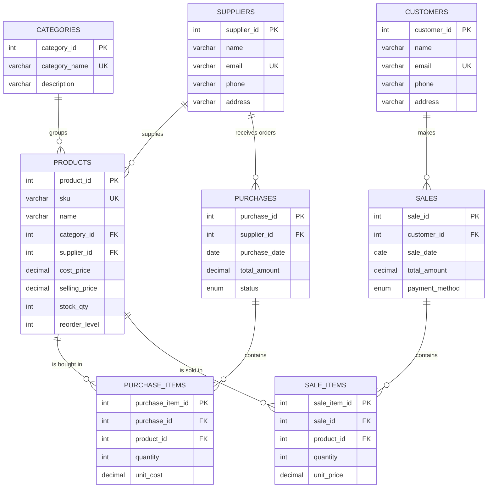

# StockPilot Inventory Management System (DBMS Project)

A full-stack Inventory Management System where **the database is the star**. Every feature visibly uses MySQL: joins, constraints, triggers, stored procedures, views, and indexes.

> The project is designed to run fully on a local MySQL server (see [Installation](#installation)), which is the recommended way to view and demo it.

---

## Table of Contents

1. [Features](#features)
2. [Tech Stack](#tech-stack)
3. [Architecture](#architecture)
4. [ER Diagram](#er-diagram)
5. [Installation](#installation)
6. [Testing](#testing)
7. [Project Structure](#project-structure)

---

## Features

**Application**

- **Dashboard:** live KPIs (total products, stock value, today's sales, low-stock count), recent sales, low-stock alerts, and sales charts.
- **Products:** search, filter by category, add, edit, delete, with stock status badges (In Stock, Low, Out of Stock).
- **Categories, Suppliers and Customers:** CRUD with add, edit, and delete.
- **Sales:** create a sale with multiple products. Stock is reduced by database triggers, and a sale larger than the available stock is rejected.
- **Purchases:** record stock coming in from suppliers. Stock and purchase totals are updated by triggers.
- **Reports:** stock value by category, top-selling products by revenue, sales by payment method.
- **Theme:** light and dark mode. The choice is saved.

**Database**

- 8 normalized tables with primary keys, foreign keys, `UNIQUE`, `NOT NULL`, `CHECK`, and `ENUM` constraints.
- 2 views: `low_stock_products`, `sales_summary`.
- 3 stored procedures: `sell_product`, `purchase_product`, `update_selling_price`.
- 3 triggers: `before_sale_item` (blocks sales without enough stock), `after_sale_item` (reduces stock and updates the sale total), `after_purchase_item` (adds stock and updates the purchase total).
- 3 indexes: `idx_product_name`, `idx_sale_date`, `idx_purchase_date`.
- Unique SKU per product, so duplicate products are rejected by the database.

---

## Tech Stack

| Layer | Technology |
|-------|-----------|
| Frontend | Next.js (App Router), React, TypeScript, Tailwind CSS |
| Backend | Next.js route handlers (REST-style API) |
| Database driver | mysql2 (promise API, connection pool) |
| Database | MySQL 8.0 |
| Tools | MySQL Workbench, VS Code, Git and GitHub |

---

## Architecture

```
Next.js Frontend (forms, tables, dashboard)
        |  fetch() / JSON
        v
Next.js Backend API (validation + parameterized SQL)
        |  mysql2 connection pool
        v
MySQL 8.0 (stockpilot)
  tables | views | stored procedures | triggers | indexes
```

All SQL runs only inside the API route handlers. The business rules (stock availability, stock updates, totals) are enforced by the database itself, not by JavaScript.

---

## ER Diagram



**Relationships**

| Parent table | Child table | Type | Foreign key |
|--------------|-------------|------|-------------|
| categories | products | One to many | `products.category_id` |
| suppliers | products | One to many | `products.supplier_id` |
| suppliers | purchases | One to many | `purchases.supplier_id` |
| purchases | purchase_items | One to many | `purchase_items.purchase_id` |
| products | purchase_items | One to many | `purchase_items.product_id` |
| customers | sales | One to many | `sales.customer_id` |
| sales | sale_items | One to many | `sale_items.sale_id` |
| products | sale_items | One to many | `sale_items.product_id` |

Products and purchases have a many-to-many relationship through `purchase_items`, and products and sales have one through `sale_items`.

---

## Installation

### Prerequisites

- **Node.js** v18.18 or higher (v20+ recommended) and **npm**
- **MySQL Server 8.0+** and **MySQL Workbench** (or the `mysql` command-line client)
- **Git**

### 1. Clone the repository

```bash
git clone https://github.com/dakshnarwaria/Inventory-Management.git
cd Inventory-Management
```

### 2. Set up MySQL

Make sure the MySQL server is running and you know your root password.

**Option A: MySQL Workbench**
1. Open a connection to your local server (for example `root@localhost:3306`).
2. Go to **File > Open SQL Script** and choose `db/schema.sql`.
3. Click the lightning bolt (**Execute**) to run the whole script.

**Option B: Command line**

Command Prompt or Git Bash:
```bash
mysql -u root -p < db/schema.sql
```

PowerShell (it does not support `<`):
```powershell
cmd /c "mysql -u root -p < db\schema.sql"
```

The script drops and recreates `stockpilot`, then creates the tables, views, procedures, triggers, indexes, and sample data. Check that it worked:

```sql
USE stockpilot;
SHOW TABLES;
SELECT * FROM low_stock_products;
```

> The script starts with `DROP DATABASE IF EXISTS stockpilot;`, so running it again resets all data to the sample data.

### 3. Create the `.env.local` file

The app reads its database credentials from `.env.local` in the project root (the same folder as `package.json`). This file is private and is never pushed to GitHub, so each person creates their own.

Copy the template (do not rename it):

```bash
# Windows (Command Prompt)
copy .env.example .env.local

# macOS / Linux / Git Bash
cp .env.example .env.local
```

Open `.env.local` and enter your own MySQL password:

```env
DB_HOST=localhost
DB_USER=root
DB_PASSWORD=your_mysql_password
DB_NAME=stockpilot
```

> **Security:** never commit `.env.local` or share your real password. `.gitignore` already excludes `.env*` files, with an exception for `.env.example`.

### 4. Install dependencies and run

```bash
npm install
npm run dev
```

Open **http://localhost:3000** in your browser. If you edit `.env.local` while the server is running, stop it (Ctrl+C) and run `npm run dev` again.

> If another project is already using port 3000, start this one on a different port: `npm run dev -- -p 3001`.

### 5. Load the large dataset (recommended)

`db/seed_large.sql` fills the database with a large, realistic dataset of customers, suppliers, categories, products, purchases, and sales. Run it after `schema.sql`:

Command Prompt or Git Bash:
```bash
mysql -u root -p < db/seed_large.sql
```

PowerShell:
```powershell
cmd /c "mysql -u root -p < db\seed_large.sql"
```

Or in Workbench: **File > Open SQL Script**, choose `db/seed_large.sql`, and click **Execute**. Refresh the app afterwards to see the new data.

### Troubleshooting

| Problem | Likely cause and fix |
|---------|---------------------|
| `Access denied for user 'root'` | Wrong `DB_PASSWORD` in `.env.local`. Fix it and restart `npm run dev`. |
| `Unknown database 'stockpilot'` | The schema was not loaded. Run `db/schema.sql` again. |
| `ECONNREFUSED` | The MySQL service is not running. Start it. |
| Pages load but show no data | `.env.local` is missing, or the schema or seed was not imported. |
| `The '<' operator is reserved for future use` | PowerShell does not support `<`. Use `cmd /c "mysql -u root -p < db\seed_large.sql"` or Command Prompt. |
| `'mysql' is not recognized` | MySQL is not on your PATH. Add its `bin` folder (for example `C:\Program Files\MySQL\MySQL Server 8.0\bin`) to PATH, or use Workbench. |
| Port 3000 already in use | Another app is running. Stop it or use `npm run dev -- -p 3001`. |

---

## Testing

### 1. Build and lint

```bash
npm run build     # type-checks and builds the app
npm run lint      # ESLint validation
```

### 2. Database tests (run in MySQL Workbench)

These use the sample data from a fresh `schema.sql` run, before loading `seed_large.sql`.

| # | Test | Command | Expected result |
|---|------|---------|-----------------|
| 1 | Trigger blocks an oversized sale | `CALL sell_product(4, 6, 50, 'Cash');` | Error: `Insufficient stock` (Sunflower Oil has 5 units) |
| 2 | Trigger reduces stock on sale | `CALL sell_product(4, 1, 3, 'UPI');` then `SELECT name, stock_qty FROM products WHERE product_id = 1;` | USB Cable stock drops from 45 to 42 |
| 3 | Trigger adds stock on purchase | `CALL purchase_product(3, 6, 40, 120);` then `SELECT name, stock_qty FROM products WHERE product_id = 6;` | Sunflower Oil stock rises from 5 to 45 |
| 4 | View shows low stock | `SELECT * FROM low_stock_products;` (run before test 3) | Only Sunflower Oil, which is at or below its reorder level |
| 5 | Totals update automatically | `SELECT sale_id, total_amount FROM sales WHERE sale_id = 1;` | `1200.00` (5 x 150 + 10 x 45) |
| 6 | CHECK constraint | `UPDATE products SET selling_price = -1 WHERE product_id = 1;` | Constraint violation error |
| 7 | UNIQUE constraint | Insert a product with the existing SKU `ELE-001` | Duplicate entry error |
| 8 | Foreign key protection | `DELETE FROM categories WHERE category_id = 1;` | Foreign key error (products still reference it) |
| 9 | Aggregate report | `SELECT p.name, SUM(si.quantity * si.unit_price) AS revenue FROM sale_items si JOIN products p ON si.product_id = p.product_id GROUP BY p.name ORDER BY revenue DESC;` | One row per sold product, highest revenue first |

### 3. Application tests (run in the browser)

| Page | What to do | Expected result |
|------|-----------|-----------------|
| Dashboard | Open the page | KPI cards, low-stock alerts, and charts show data |
| Products | Add, edit, search, then delete a product with no history | Table updates, toast confirms each action |
| Products | Delete a product that has sales | Friendly foreign key error message |
| Sales | Sell more units than are in stock | "Insufficient stock" error toast |
| Sales | Create a valid sale | The product's stock goes down and the sale total is correct |
| Purchases | Record a purchase | The product's stock goes up |
| Categories | Delete a category that has products | Friendly foreign key error message |
| Theme | Click the dark/light toggle and refresh | The chosen theme stays |

---

## Project Structure

```
Inventory-Management/
├── .env.example          # Environment variable template (safe to commit)
├── db/
│   ├── schema.sql        # Tables, views, procedures, triggers, indexes, sample data
│   └── seed_large.sql    # Large realistic dataset
├── lib/                  # Database connection pool and helpers
├── components/           # Shared UI (Header, Sidebar, Modal, StatCard, StockBadge,
│                         #   RdbmsBadge, ThemeToggle, Toast)
├── src/                  # App Router pages and API route handlers
├── public/               # Static assets
└── package.json
```

---
