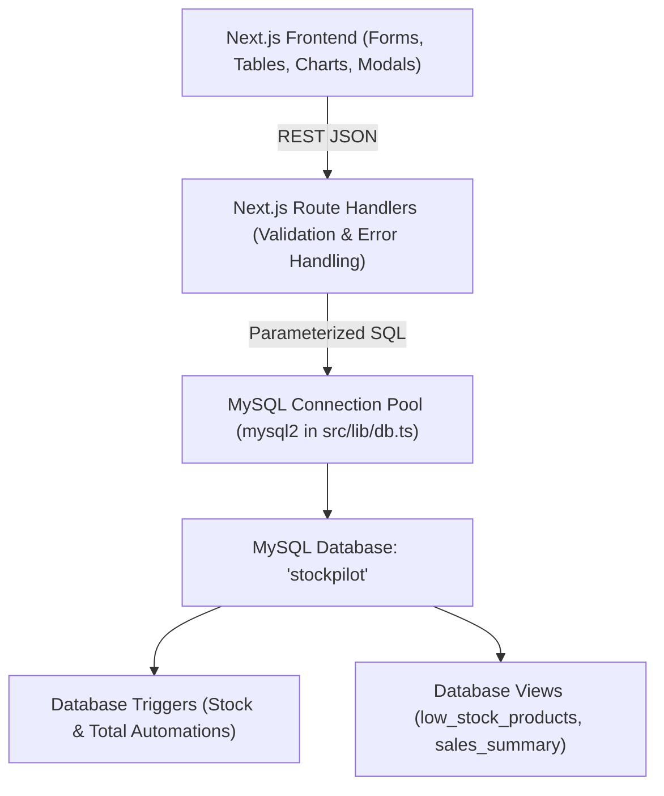

# StockPilot — Inventory Management System

A full-stack inventory management application backed by MySQL. It demonstrates relational database concepts including automated triggers, stored procedures, views, foreign-key integrity constraints, and ACID transactions.

Backed by **Next.js 16 (App Router)**, **TypeScript**, **Tailwind CSS v4**, and native connection pooling with **`mysql2`**.

---

## Architecture Overview



---

## Database Features (MySQL `stockpilot`)

### 1. Relational Schema (8 Tables)
- `categories`: Product category hierarchy (`category_id`, `category_name`, `description`).
- `suppliers`: Vendor records (`supplier_id`, `name`, `email`, `phone`, `address`).
- `customers`: Client directory (`customer_id`, `name`, `email`, `phone`, `address`).
- `products`: Catalog items with foreign keys to categories and suppliers, prices, `stock_qty`, and `reorder_level`.
- `purchases` & `purchase_items`: Procurement orders and line items.
- `sales` & `sale_items`: Customer orders and line items with payment methods (`Cash`, `Card`, `UPI`).

### 2. Active Triggers
- **`before_sale_item`**: Checks available warehouse stock before inserting a sale line. If `available < NEW.quantity`, raises:
  ```sql
  SIGNAL SQLSTATE '45000' SET MESSAGE_TEXT = 'Insufficient stock';
  ```
- **`after_sale_item`**: Automatically decrements product stock (`stock_qty = stock_qty - NEW.quantity`) and accumulates `sales.total_amount`.
- **`after_purchase_item`**: Automatically increments product stock (`stock_qty = stock_qty + NEW.quantity`) and accumulates `purchases.total_amount`.

### 3. Database Views
- **`low_stock_products`**: Automatically aggregates products where `stock_qty <= reorder_level` with joined categories and suppliers.
- **`sales_summary`**: Summarizes customer sales with total order amounts and payment methods.

### 4. Stored Procedures
- `sell_product(customer, product, qty, payment)`
- `purchase_product(supplier, product, qty, cost)`
- `update_selling_price(product, price)`

---

## Setup & Running Locally

### Prerequisites
- Node.js 18+ (tested on Node.js 20 & 24)
- MySQL Server (running locally on port 3306)
- MySQL Workbench or MySQL CLI

### Step 1: Install Dependencies
```bash
npm install
```

### Step 2: Configure Environment Variables
Copy `.env.example` to `.env.local` and configure your local MySQL credentials:
```bash
cp .env.example .env.local
```

Edit `.env.local`:
```env
DB_HOST=localhost
DB_USER=root
DB_PASSWORD=your_mysql_password
DB_NAME=stockpilot
```

### Step 3: Initialize Database Schema
Run the SQL schema in MySQL Workbench or via terminal:
```bash
mysql -u root -p < db/schema.sql
```
This creates database `stockpilot`, all 8 tables, indexes, triggers, stored procedures, views, and initial seed data. **The schema script drops and recreates the `stockpilot` database**, so do not run it if you need to preserve existing data.

### Step 4: Load the full sample dataset
Run this after schema setup to load the full demonstration inventory:
```bash
mysql -u root -p < db/seed_large.sql
```
This loads 20 categories, 75 suppliers, 550 customers, 100 products, purchase orders, and 120 sample sales. The seed script **clears all existing rows** in the inventory, customer, supplier, purchase, and sales tables before loading its sample data. Do not run it against a database containing data you need to keep.

### Step 5: Run Development Server
```bash
npm run dev
```
Open [http://localhost:3000](http://localhost:3000) in your browser.

---

## Pages & UI Walkthrough

1. **Dashboard (`/`)**:
   - 5 KPI metric cards: Total Products, Total Stock Value (₹), Low Stock Count, Today's Sales (₹), Today's Purchases (₹).
   - Low stock alert table directly from MySQL `low_stock_products` view.
   - Recent sales from MySQL `sales_summary` view.
   - Sales-by-category revenue distribution chart.
   - SQL schema inspection modal for reviewing database triggers, views, and stored procedures.

2. **Products Catalog (`/products`)**:
   - Filterable data table with search and category dropdown.
   - Stock status badges: **Healthy** (Green), **Low Stock** (Amber), **Out of Stock** (Red).
   - Add, edit, and delete product modal forms with validation.
   - Foreign key constraint delete safety (blocks deletion if referenced in sales/purchases).

3. **Categories, Suppliers & Customers (`/categories`, `/suppliers`, `/customers`)**:
   - Full CRUD tables with search, modals, and input validation.

4. **New Sale (`/sales/new`)**:
   - Pick customer and payment method (`Cash`, `Card`, `UPI`).
   - Add multiple product lines with live estimated subtotal and unit price auto-filled from `products.selling_price`.
   - Executed inside a **single-connection ACID transaction**.
   - If stock is insufficient, the MySQL trigger raises `SIGNAL 45000` and rolls back the transaction, presenting a friendly toast notification.

5. **New Purchase Order (`/purchases/new`)**:
   - Select supplier, receipt status, and product lines with editable unit costs.
   - Supports URL pre-filling from low-stock restock actions (`?product_id=...&supplier_id=...`).
   - Commits inside a transaction; warehouse stock is increased automatically by trigger `after_purchase_item`.

6. **Transaction History (`/history`)**:
   - Tabbed view for Sales and Purchases.
   - Expandable rows displaying itemized line details (`sale_items` and `purchase_items`).

7. **Low Stock Alerts (`/low-stock`)**:
   - Live query from MySQL view `low_stock_products`.
   - Displays stock deficits with a direct **"Restock"** action button that pre-fills New Purchase.

---

## Design Theme: "Warehouse Amber"

- **Theme Palette**:
  - Dark Mode: Background `#0B1220`, Surface `#111A2E`, Border `#1F2A44`, Primary `#F59E0B`.
  - Light Mode: Background `#F8FAFC`, Surface `#FFFFFF`, Border `#E2E8F0`, Primary `#D97706`.
  - Status Colors: Success `#22C55E`, Danger `#EF4444`, Info `#38BDF8`.
- **Theme Toggle**: Located in the top navigation bar, persists user choice in `localStorage`, and respects system preferences.
- **Responsiveness**: Collapsible mobile sidebar with backdrop drawer and responsive data tables.
